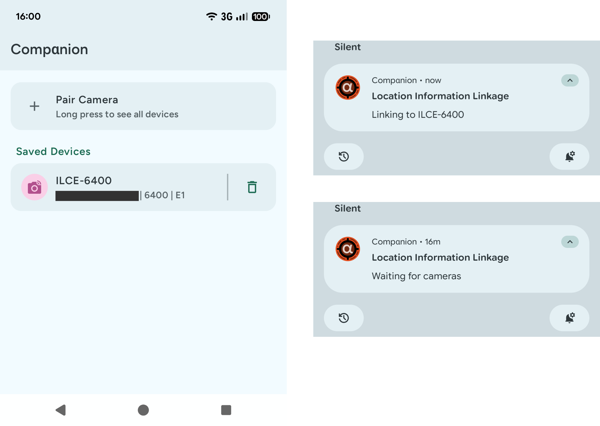

# Alpha Companion

**⚠️ This app is still quite experimental, so feedback is very welcome! ⚠️**

A simple Android app to stream location data to your Sony Alpha camera. It works with the Android OS to be more reliable and stable than the original Sony app.

## Startup

Currently, Alpha Companion does **not** ask for permissions and will crash if it does not have them. You can go into the settings and grant them manually. This will be fixed in future releases.

## Debugging Problems

I only have an Alpha 6400 to test this app with. As far as I can tell it should work with any 6000 series camera, but the 7 series will probably not work yet.

If you cannot find your device when tapping on the pair button, try long pressing the pair button. Please also submit an [issue](https://github.com/teccheck/alphacompanion/issues/new?template=camera-support.md) if that is the case. If you tap on a device in the list of paired devices, and the device is reachable trough BLE, you'll see a screen with a lot of technical information. At the bottom of this screen you can copy this information to put it into the issue. I need this information to implement support for new cameras.

## Tested Cameras

- ✅ Alpha 6400

## Features

- Stream location data to your camera
- Uses the Companion Device Manager APIs to save power
- Allows multiple simultaneous connections

## Screenshots

